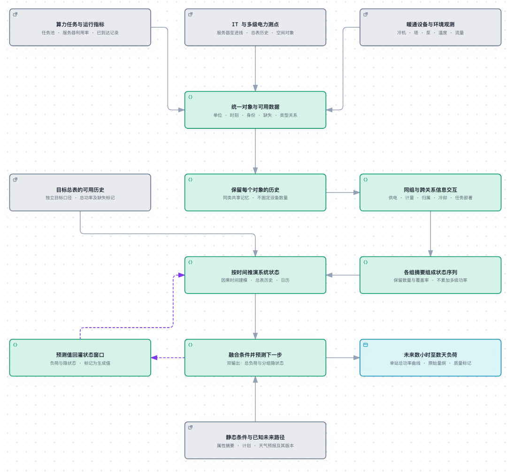

# GSLAformer R4：架构图与数据流说明

> 状态：拟议模型架构，尚未实现或训练。基于 [原 v4.0 图](v4.0.png)重新表达，保留分组空间编码、时间建模、双输出与隐状态回灌；不是简单换标签。
>
> [打开交互架构图](architecture.html) · [可编辑图源](architecture.json) · [输入输出合同](../input_output.md) · [实施规格](../implementation.md)

## 1. 更新后的架构图

PNG 是已验证 HTML 的浅色浏览器渲染截取，方便 Markdown 阅读；交互 HTML 可缩放和导出。原 `docs/model_arch/v4.0.png` 经文档目录整理后与本图统一保存在当前目录，文件名为 `v4.0.png`，图像内容不变。图源中的 schema_version=1 是**绘图格式版本**，与模型／数据 schema_version=3 无关。

图采用业务语言，矩形表示输入或处理过程，实线是前向数据流，虚线是预测值反馈。箭头不附文本，输入输出含义写在方框内。上方三块是采集来源的视觉归并，不是模型只有三个分组；实际六组及变量形状见 §3。

“跨 AIDC”表示同一类型合同下多个站点共享参数及独立推理，不表示多个站点实时互相交换信息。图是单个站点、单个预测 origin 的逻辑流；一个 batch 可并行包含多个这样的独立请求。

## 2. 原图到当前设计的对应关系

| 原图内容 | R4 如何保留／扩展 | 为什么需要 |
| --- | --- | --- |
| 用户层 | 算力任务池与历史运行指标，必要时按实际部署粒度关联设备 | 用户静态属性不足以描述 GPU 任务负载与计划变化 |
| 机房层／楼宇层 | IT 电力、配电、暖通、空间、环境各组，不限制为三个层级 | 服务器、机柜、UPS、变压器与泵的物理含义不同 |
| Space Positional Encoding | 类型／属性编码与 typed relations；不用实体行号或 ID 参数 | 新站设备数量与顺序不同，不能依赖固定槽位 |
| 各组 Multi-Head Attention | 保留组内空间注意力，之前增加共享实体因果历史编码，之后增加类型关系注意力 | 保住同一实体跨时轨迹，并利用真实业务连接 |
| 横向拼接 | 每组关系增强后查询读出，再按固定组顺序拼接 | 拼接固定宽度摘要，不展平数量可变的设备轴 |
| 时间纵向排列 | 每个历史时刻一个系统状态 token，显式加入总表与质量标记 | 内部观测可能不完整，总表历史不能被隐含丢弃 |
| Time Positional Encoding | 窗口位置与日历分开；追加预测态后按其时间重新编码 | 防止错位和回灌时重复叠加编码 |
| Masked Multi-Head Attention | 因果时间 Transformer | 时间链只访问当前及之前状态，不访问未来真实观测 |
| Linear 总负荷 | 每步一个总功率值，收集为 H 步业务曲线 | 目标是设施总负荷，不是强制逐节点预测 |
| multi Linear → next embedding | 各动态组一个规范隐状态预测头，按组拼接回灌 | 保留原图明确要求的状态闭环 |
| 原图未画的条件旁路 | 静态属性摘要与起点已知的完整未来计划／天气路径 | 不用未来实际值替代计划，同时保证 direct 与 AR 信息公平 |

“任何时序结构都可适用”视为原图的可扩展想法，不解释成当前代码已支持任意时间骨干。首版固定因果 Transformer；替换 TSMixer、RNN 等是后续显式变体。

## 3. 从原始输入走到系统状态

### 3.1 六组输入与身份对齐

六组分别为 `compute`、`it_power`、`distribution`、`hvac`、`space`、`environment`。每组历史 `X[g]` 形状为 `[B,L,N_g,F_g]`，另有属性、observed/applicable/present/padding 和逐时刻关系。

先以 `(site_id,group,entity_id)` 对齐整段历史，再做特征适配。N_g 随站点／请求变化，F_g 由训练 schema 固定。ID 仅做对齐与审计，不查可学习 ID 表；缺测和不适用不当真实零值。

图中“目标总表的可用历史”是同一原始数据经过目标合同选择后的独立输入视图，不是另造一份总表。它显式旁路到时间建模，避免读者误以为网络只能从设备重建总负荷。

### 3.2 先实体历史，再组内与跨类型交互

每个动态实体使用同组共享的单向 GRU 保留过去变化，输出 `[B,L,N_g,d_s]`。每个时刻再做同组 attention，然后按供电、计量、空间、冷却、任务部署等类型关系交换信息。

属性和关系可以在历史内按当时有效版本变化；起点后的未来上下文固定。两层关系 attention 只提供局部两跳交互，不等同于完整电力层级逐级汇总，不把 attention 解释为功率流或因果图。

### 3.3 关系增强后读出

每组通过查询读出形成固定宽度状态，加入有效数量与覆盖率，再 LayerNorm。动态组状态拼接为 `[B,L,Gd*d_z]`；纯静态组仅参与独立静态条件。AIDC 六组都声明动态特征，故其 Gd 固定为六，即使某请求的一组为空也不删除该组槽位。

这里加总／拼接的是隐表示和属性统计，不是把服务器、机柜、UPS、楼宇等功率重复累加。空组使用专门 token 和零质量；数据不足仍可能导致低精度，有限输出不是可靠性保证。

## 4. 时间预测、条件融合与回灌

### 4.1 系统时间 token

每个时刻将分组规范隐状态、标准化总负荷、观测／生成来源和分组覆盖率一起投影，再加入时间位置与日历。因果时间 Transformer 输出当前末端隐藏表示。

图中“静态条件与已知未来路径”汇合了两条独立计算：静态属性读出 c 与 FuturePathEncoder 的 p。c 不读动态观测；p 读整个原起点已知的 H 步计划／预报及 mask。图将它们归并为条件入口以便阅读，不表示用同一编码器处理。

### 4.2 双头的准确含义

融合当前时间隐藏表示、c、p 的第 k 步与相对原 origin 的 lead(k)，同时预测：

- `y[o+k]`：下一步总负荷；
- `z[o+k,g]`：下一步各动态组规范隐状态。

两头的目标时刻一致。输出 H 步总负荷需运行 H 次预测，不是把一次一步输出重复 H 次。未来条件在原点编码一次，递推过程中不能重新读取后来发布的计划。

### 4.3 反馈的是预测状态，不是未来设备真值

反馈到时间窗口的是同一步预测 y 与 z，附 generated=true、observed=false、coverage=0。移除最早 token 后进行下一步；历史空间编码只做一次，不把预测 z 拆回服务器特征或实体 GRU memory。

图中虚线形成完整反馈环，但该环不经过原始数据读取或实体编码；因此生产推理不依赖未来内部测点。未来设备实测只出现在隔离 teacher 路径，作为训练标签，绝不走图中的生产反馈线。

## 5. 训练图与推理图的区别

上图展示完整模型的推理逻辑。训练不是从零同时拟合全部 latent 标签：

1. **阶段 A**：用同一实体／空间链学表示，直接预测完整 H 步总负荷；不走预测态回灌，不用 latent loss。
2. **冻结**：选择 best_A，冻结表示链和静态链，统计训练 origin 的 latent 方差／有界权重。
3. **阶段 B**：保持时间／未来路径／融合／双头可训练，自由递推从短课程到完整 H。冻结 teacher 由历史实体记忆副本及未来观测构造标签，只进损失。
4. **验证／测试**：完全自由递推，最终测试站点不参与选模。
5. **forecast**：加载最终模型／schema／scaler，输入包无标签，输出原始量纲总负荷及审计标记。

阶段 A 的 direct 路线也是必需对照，拿到与完整 AR 相同的起点已知未来路径。只完成阶段 A 不等于实现了原图的回灌模型。

## 6. 图示之外的工程边界

- 原始映射、分区、scaler、配置解析、checkpoint 与 CSV/NPZ 保存由数据／实验框架承担，不放入模型方框伪装成网络层。
- 模型通过现有 `run.py` 独立路由接入；普通时序模型继续走现有主链。详见 [integration.md](../integration.md)。
- 模拟数据是图的输入来源之一，不是网络在线自生成训练真值的路径。
- 小时至三天要按对应完整 profile 验收；图中没有表示无限 horizon 或无限设备数。
- 绘图校验／浏览器检查只证明图示可读、连接可渲染，不能证明这些模型组件已经实现。

## 7. 图源与证据维护

修改 `architecture.json` 后重新执行 Archify 的完整 finalize，再检查真实浏览器渲染；不要直接改生成 HTML。图源、HTML、PNG 与证据绑定在同一版本，不能拿旧截图证明新图通过。

首次绘图命令与历史校验结果记录在 [validation_r4.md](../validation_r4.md)，迁移前回执保留在 [diagram_evidence/architecture.finalize-summary.json](diagram_evidence/architecture.finalize-summary.json)。新路径的当前回执位于 [diagram_evidence/relocation/architecture.finalize-summary.json](diagram_evidence/relocation/architecture.finalize-summary.json)，目录约定见 [README.md](README.md)。图源不绑定仓库已有模型实现的虚假 source 行号：这是设计图，代码复用事实由 integration 文档单独列出。
