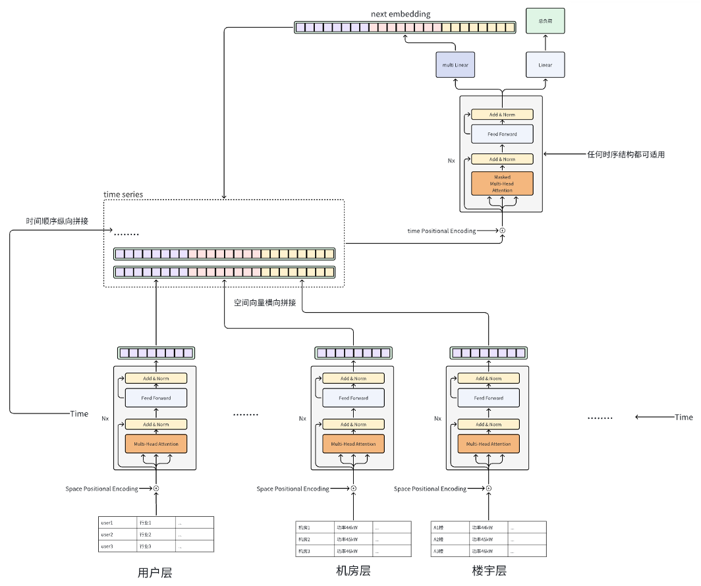

# GSLAformer：模型设计与开发方案

> 模型工作名：GSLAformer — Grouped Spatial Latent Autoregressive Transformer。
>
> 中文名：分组空间隐状态自回归 Transformer。
>
> 文档性质：基于 v4.0 架构图、经用户决策扩展的模型设计。
>
> 设计版本：R2（修订差异与决策依据见 §12.1）。
>
> 状态：已补充实施依据，模型尚未实现；本次只授权完善文档，不授权模型开发。
>
> 名称边界：项目工作名称，不宣称公开名称唯一，不代表已发表模型或已经验证的原创贡献。
>
> 治理依据：仓库根目录 `AGENTS.md`；本文件不替代项目任务登记。
>
> 证据边界：仓库接口与环境经过只读核查；没有执行本模型训练、测试或性能复现。

配套文档：[开发实施规格](implementation.md)。本文件定义模型语义与范围，实施规格定义接口、配置、训练状态机、测试和任务；两者不一致时必须修正文档，不能由开发者静默选择。

**用户已决策：首轮只交付模型与功能测试，真实数据验收暂不启动；同一系统新增实体无需重训即可预测；归属表必须参与计算；支持通用未来协变量接口；不强制优于对照，但必须如实报告。**

## 1. 结论与范围

把 v4.0 扩展实现为：**归纳式分组空间编码器 + 实体级归属关系注意力 + 因果时间 Transformer + 总负荷／下一状态双预测头**，完整保留 embedding 回灌闭环。关系交互是用户此次明确要求的扩展，不声称原图已画出该模块。

参考 ViViT、PoseFormer 的空间—时间拆分方式，但不直接引入它们的整个训练工程。使用当前项目已有的 PyTorch，实现模型核心，并新增适合分组输入与双头监督的数据、实验流程。

真正需要重点设计的不是 Transformer 方框，而是：

1. 一个空间分支输出的向量代表什么；
2. 历史真实 embedding 与未来预测 embedding 如何保持一致；
3. 两个预测头的监督时刻如何对齐；
4. 递推训练如何与实际推理一致。

### 1.1 建设目标

- 实现图示分组空间编码、时间建模、双头输出和状态回灌。
- 建立无数据泄漏、可重载、可测试的训练—验证—测试—预测链路。
- 通过消融区分输入信息、空间编码和 latent 递推分别带来的收益。
- 输出一个系统级总负荷预测；不因输入包含多个实体而强制预测每个实体。
- 同一 schema 下新增实体，使用属性、观测和归属关系生成表示，不新增模型参数、不重新拟合 scaler、不重训。
- 归属表在实体汇总前参与空间计算，并有关系干预测试证明实际使用。
- 首轮验收合成数据上的完整训练／测试／无标签 forecast 与重载，不要求真实业务数据或预测优势。

### 1.2 非目标

- 不加入图卷积或复杂模型融合；**实体级跨分组归属注意力已纳入首版**，替代初稿的排除项。
- 不承诺新增对象类型、全新系统零样本迁移、预测区间内未来拓扑切换或生产预测精度。
- 不默认具有节点功率预测、物理守恒或层级协调能力。
- 不把 attention 权重直接解释为物理因果关系。
- 不以名称、图形相似或训练可启动证明原创性和预测优势。
- 不重构与该模型无关的已有模型或实验流程。

最小替代方案是“分组空间编码 + 直接多步输出”。它保留为必要对照，但不替代本次完整 v4.0 模型的交付目标。

## 2. 原图与架构语义



### 2.1 数据流

```text
[各组实体的历史观测与属性]
                │
                ▼
[各组独立的空间编码器]
                │
                ▼
[按归属表在实体间交换信息]
                │
                ▼
[各组读出与静态条件汇总]
                │
                ▼
[同一时刻的分组向量横向拼接]
                │
                ▼
[多个时刻组成状态序列] ◀──────────────┐
                │                    │
                ▼                    │
[时间编码 + 因果时间模型]             │
                │                    │
          ┌─────┴──────┐             │
          ▼            ▼             │
    [下一步总负荷] [下一步状态向量] ───┘
```

必须区分两种“多个”：

- 同一时刻有多个空间分组，分别编码后拼接；
- 不同时间步重复使用同一套空间编码器，不为每个时刻训练新参数。

推荐不同分组采用独立的特征适配器和空间编码器，同一分组跨时间共享参数。时间模型的一个 token 表示整个系统在一个时刻的压缩状态。

图中的用户层、机房层、楼宇层作为配置中的分组名称，不写死在模型类里。内部采用 `groups`，业务含义由数据映射声明。

### 2.2 原图边界与本次关系扩展

图示为分组空间编码与后期融合，没有明确给出用户属于哪个机房、机房属于哪个楼宇的关系矩阵，也没有跨层级消息传递。

因此，原图本身不能视为已经实现显式关系建模。本次用户选择“加入，提供归属表并让关系参与计算”，设计增加实体级关系注意力：组内编码后、分组汇总前，按子级／父级连接交换信息；不是只拼接父级 ID 或保存一张闲置关系表。

归属不等于电气连接，也不意味着功率可加。不同层级测量可能重复覆盖相同负荷，不能直接相加。关系类型、方向及有效期必须显式声明。

### 2.3 新增实体免重训的边界

- 分组类型、特征 schema、关系类型固定；每组实体数量可变，允许首次见到的实体 ID。
- ID 仅用于去重、对齐、关系索引和审计；**不进入可学习的按实体 ID 查表，也不使用按行位置的空间编码**。
- 按组共享属性／数值编码器、可变长度 attention 与池化，使参数形状不依赖实体数量。
- 新实体有历史则按实际历史编码；没有历史则使用静态属性、已知关系与缺失标记，输出标注冷启动。能力是能够执行预测，不保证冷启动精度。
- 允许新父节点与子节点一起加入，只要类型和关系符合已训练 schema。新增分组或特征类型需另行配置与训练，不等于新增实体。
- 一个预测请求采用起点时已知、经过有效期验证的关系快照；不支持在未来 horizon 内编造或自动推演关系变更。关系版本切换需重新发起预测，不重训。

## 3. 数据契约

### 3.1 分组动态输入

每组历史观测为：

\[
X^{(g)}\in\mathbb R^{B\times L\times N_g\times F_g}
\]

- `B`：batch；
- `L`：历史长度；
- `N_g`：该组实体数量；
- `F_g`：该组动态特征数量。

使用分组张量，不把所有业务数据硬塞进一个无映射说明的宽表。

| 字段 | 作用与约束 |
| --- | --- |
| `values[g]` | 分组历史动态观测 |
| `observed[g]` | 与数值对应的缺失掩码，零不是通用缺失标记 |
| `applicable[g]`、`present[g]`、`padding[g]` | 区分特征不适用、实体尚未生效与 batch 补齐 |
| `entity_ids[g]` | 实体身份和显式映射，仅作元数据，不作为可学习 ID 索引 |
| `static_features[g]` | 类别、位置、设备属性等 |
| `relations` | 起点可用的归属边及有效版本；实际进入关系注意力 |
| `history_time` | 历史时刻和时间特征 |
| `future_time` | 预测区间已知的时间信息 |
| `future_known`、`future_known_mask` | 通用未来协变量，按预测起点版本对齐；零列表示未配置 |
| `target_history` | 起点前可获得的历史总负荷 |
| `target_history_observed` | 历史总负荷有效性；缺失填充与数值分开 |
| `target_future` | 仅训练、评估使用的未来总负荷标签 |
| `target_observed` | 未来目标有效性掩码 |

历史总负荷固定作为附加输入，在时间 token 中与动态 latent 拼接；不是可选的暗含分支。内部测点未必覆盖总表口径，不能假设空间分支能够完整重建总负荷。缺失历史总负荷由 mask 表达，不用未来值补齐。

### 3.2 静态属性与动态状态分离

如果一组只有行业、设备类型等静态属性，它提供静态条件，不因按时间复制就成为动态信息。不能强迫模型每一步重新预测这些静态属性。

`next embedding` 准确定义为**由静态属性和关系条件化的动态观测表示**，不宣称 latent 在数学上已经把身份和动态信息完全解耦。纯静态分组输出固定条件，没有状态预测头；混合分组允许状态含有静态信息，但不输出实体身份或重新生成属性。

静态条件通过独立静态属性读出生成，不能从包含动态观测的最后一帧 hidden state 冒充得到。动态分组至少一个，否则拒绝作为 GSLAformer 训练。

### 3.3 数据治理

- 明确目标总表边界、单位、采样频率和时间戳区间语义。
- 记录每个实体、特征对应的来源；各数组使用一致的实体映射。
- 动态观测统一到规则时间轴；缺失和不适用分别表达。
- 按时间划分训练、验证和测试，标准化器仅拟合训练观测。
- 采用 target-anchored split：全部预测标签属于一个分区；历史可来自更早分区，但只能取预测起点前已可用的数据，scaler 始终不重拟合。
- 预测起点只能使用当时已到达的数据。事后补采和修订不能无条件回填为当时可用的信息。
- 未来计划仅在预测起点已知时可作为条件，未来实际观测只可作为标签。
- 未知属性类别使用 `UNK`，首轮功能配置以合成类别覆盖训练；新实体不新增身份 embedding，不复用旧实体 ID。scaler 按组／特征跨训练实体拟合，以支持未见实体。
- 不凭口头层级关系推断供电关系、守恒关系或互不重叠的功率分量。

## 4. 模型模块

### 4.1 特征适配与空间信息

每个分组执行：连续值与 mask／类别属性映射 → 组内空间 Transformer → 按归属表交换实体信息 → 分组读出。实体数量可变，映射和权重不依赖实体 ID。

区分三类编码：

| 编码 | 为什么需要 | 示例性质 |
| --- | --- | --- |
| 实体 ID 元数据 | 对齐和追踪对象，不作为模型数值输入 | 新增机房无需创建新的参数行 |
| 静态属性 embedding | 告诉模型具有什么属性 | 设备类型、行业类别 |
| 关系 attention mask | 明确哪些实体交换信息 | 子级从所属父级读取信息，父级读取已登记子级 |

坐标仅在 schema 已声明时作为数值属性使用，不强制提供。正式 `full` 模式要求有效归属表，缺失时报错；空关系仅允许在明确的 `no_relation` 消融模式，不静默降级。

### 4.2 组内空间 Transformer

将 batch 和时间维合并：

\[
[B,L,N_g,d_s]\rightarrow[B L,N_g,d_s]
\]

在每个时间片内，仅对该组实体做 attention。该模块学习同一时刻的组内关系，不在空间编码阶段混入未来时间信息。

优先使用 PyTorch 内置 `TransformerEncoderLayer`，不自行重写 Q/K/V 和注意力内核。对缺失特征使用特征掩码和明确的输入表示，对 padding 实体使用实体级 attention mask；两者不能混为一个标记。

组内加入有效的摘要 token 以避免空组 attention 全遮罩。组内层完成后保留实体输出，将其送入关系层；最终分组摘要必须在关系交互后重新读取，不能沿用关系交互前的摘要。

**关系层**使用所有组的有效实体作为 token，允许 self、已声明的子→父及父→子通信，其他边屏蔽。源表只登记子→父归属，反向通信由模型明确生成，不代表物理反向供电。方向使用类型级偏置，不使用端点 ID 参数。固定采用两层关系注意力，使多级归属可在实体汇总前传播；不直接连接所有跨组实体。

单元测试在受控权重和可区分属性下交换父级，验证允许边／消息与输出变化；不能要求每一份训练权重对每次关系改动都产生不同预测。普通 attention 仍能学到忽略关系，实际收益须由消融判定。

### 4.3 分组读出：推荐 `[CLS]`

标准 Transformer 输出实体序列，图示需要分组向量。推荐每组加入一个可学习的摘要 token，读取其输出形成分组状态：

\[
z_t^{(g)}=\operatorname{Readout}_g(\operatorname{RelationAttention}(\{\operatorname{SpatialEncoder}_j(X_t^{(j)})\}_j,R_t))
\]

| 方案 | 优点 | 代价 |
| --- | --- | --- |
| `[CLS]`，推荐 | 固定输出宽度，支持 padding，时间模型不随实体数量直接膨胀 | 压缩可能损失局部信息 |
| 全部实体展平 | 保留固定实体槽位，适合小规模固定实体集合 | 绑定数量和顺序，时序输入可能很大 |
| 均值池化 | 最简单的读出对照 | 表达能力较弱 |

`[CLS]` 是对原图未明确部分的实现选择，不是原图已经指定的事实。新版要求新增实体免重训，因此首版排除实体展平作为正式路径；表中展平仅保留为历史方案比较。

最终读出用 `[CLS]` 查询关系增强后的有效实体，同时拼接每组实体数量、观测覆盖率，再投影到固定宽度。静态条件另附静态数值属性的 masked mean／sum 和有效数量，避免平均型读出完全丢失新增实体导致的规模变化；该设计不保证模型自动满足功率可加性。

全缺失分组必须有明确行为：保留有效摘要 token，结合缺失条件生成有限表示，不让注意力整行被屏蔽后产生 NaN；对应 latent 监督按有效性屏蔽。

### 4.4 分组拼接与规范 latent 空间

\[
z_t=z_t^{(1)}\Vert z_t^{(2)}\Vert\cdots\Vert z_t^{(G)}
\]

仅动态分组进入状态拼接，各组输出相同宽度，并使用各自的 LayerNorm。LayerNorm 后的拼接空间为规范 latent，也是预测头输出与回灌空间；纯静态组进入独立条件，不占动态预测头。

步骤 B 冻结从特征适配、组内编码、关系层、读出到 LayerNorm 的整个表示链及静态条件编码器。latent 的训练统计标准差只用作损失加权，不改变预测头输出坐标；不做回灌反标准化，也不再次对预测 latent 做 LayerNorm。标准差下限与常量维处理见实施规格。

时间模型允许另做输入投影，但 next embedding 必须预测投影前的规范状态；回灌时再次通过相同输入投影。

以下表示必须区分：

- 规范分组状态向量；
- 已加时间编码的时间模型输入；
- 时间 Transformer 中间 hidden state。

不能仅因维度相同就把三者相互替代。

### 4.5 因果时间 Transformer

图中没有 encoder-decoder cross-attention，因此不需要完整 `TransformerDecoder`。推荐使用 `TransformerEncoderLayer` 加显式 causal mask：

- `batch_first=True`；
- 按图采用 Post-LN；若后续改 Pre-LN，记录为显式变体；
- 区分序列位置编码与日历时间特征；
- 第一版不做 KV cache，先保证递推正确；
- 不只依赖 `is_causal` 提示，必须测试实际遮罩语义。

追加预测状态时不携带已叠加的时间编码，下一轮按该状态对应时刻加入时间信息，防止重复累加。

时间 token 固定由规范动态 latent、标准化总负荷、有效性／来源标记、分组观测覆盖率拼接后线性映射，再加窗口内位置与历史日历编码。当前请求的静态条件独立进入输出融合层。

### 4.6 双预测头与时间索引

\[
h_t=F(z_{\le t},y_{\le t},q_{\le t},\operatorname{time}_{\le t})
\]
\[
a_t=\operatorname{Fusion}(h_t,c,\operatorname{calendar}_{t+1},u^{known}_{t+1},m^{known}_{t+1},\operatorname{lead}(1))
\]
\[
\hat y_{t+1}=g_y(a_t),\qquad \hat z_{t+1}^{(g)}=g_z^{(g)}(a_t)
\]

- `Linear`：下一步总负荷；
- `multi Linear`：每个动态分组一个状态头；
- 各状态头输出按规范分组顺序拼接；
- 两个头均监督到 `t+1`。

其中 `q` 包含质量／来源信息，`c` 是与动态观测分开的静态条件，`u` 为预测起点已经知道的未来条件。两个头在输出前都显式看到目标时刻日历和未来协变量。已配置但不可用的协变量数值置零并 mask；未经训练就新增协变量列不在免重训能力范围内。

不能一个头预测当前时刻、另一个预测下一时刻。追加下一状态后再运行模型产生的是再下一步输出，不能重复标记为同一个时刻。

## 5. 训练方案

### 5.1 为什么不直接端到端加 latent MSE

随机初始化后同时训练编码器与 latent 预测，存在以下风险：

- 编码器更新导致监督目标持续移动；
- 缩小表示尺度可能降低损失但不增加有效信息；
- 一步 latent 拟合好不意味着多步递推稳定；
- 部分分组可能被忽略或退化。

推荐“先用总负荷学空间表示，再冻结表示训练完整递推”。第一版不同时加入 EMA teacher 和复杂自监督目标，避免难以定位失败原因。

### 5.2 训练步骤 A：用多步负荷监督学习空间表示

链路为：关系增强的空间编码 → 时间模型 → 按目标时刻条件查询的直接多步总负荷。此处从初稿的一步监督改为完整 horizon 监督，减少“只保留一步有效信息、冻结后无法支持长时递推”的风险。

- 不使用 latent loss；
- 只使用起点前真实历史，各未来 horizon 用该时刻已知条件和 lead 编码查询同一个历史 hidden state；没有未来 latent 输入；
- 总负荷损失反向传播到空间编码器；
- 只使用训练区间拟合，验证集用于选优；
- 检查分组状态方差、时间变化及移除分组后的影响。

各 horizon 共享条件融合层与总负荷线性头，lead 采用确定性正弦编码。步骤 B 继承空间链、时间链、静态链、条件融合与总负荷头；只新启用 latent 头，并重建优化器。B 每次预测相对当前窗口的下一步，lead 固定为 1。直接多步对照可直接采用步骤 A 架构，但须按对照训练预算运行。

多步监督仍不保证状态可递推，加入总负荷历史也可能使模型忽视空间分支。必须记录分组方差与受控移除／重新训练消融；若无空间增益，报告该事实，不通过扩大层数掩盖。真实效果验收已延期，不把“必须产生空间增益”设为首轮功能门槛。

该步骤为完整闭环提供表示空间，不是 v4.0 的最终交付。只完成这一步不能称模型已实现。

### 5.3 训练步骤 B：冻结空间表示，训练双头与递推

选定空间编码器后：

- 冻结整个表示生成链及静态条件编码器，设置 `eval`；
- 固定属性类别词表、特征 schema 和训练标准化器；实体 ID 清单仅作训练溯源，推理允许新增 ID；
- 防止外层 `model.train()` 意外重新启用冻结编码器的 dropout；
- 真实历史输入与未来监督目标使用同一固定编码方式。

未来真实观测可在训练时经过冻结编码器形成 latent 标签，但只能进入损失，不能进入自由递推输入。

\[
\mathcal L=\mathcal L_{\text{load-rollout}}+
\lambda\frac{1}{|\mathcal G_{\text{dynamic}}|}
\sum_{g\in\mathcal G_{\text{dynamic}}}\mathcal L_{\text{latent}}^{(g)}
\]

建议：

- 总负荷采用标准化空间中的 masked MSE；
- latent 损失为规范空间误差除以训练标准差后计算 MSE；标准差仅加权损失，不改变回灌坐标；
- 动态分组等权聚合，避免大分组天然占优势；
- 纯静态分组不承担 latent 预测损失；
- 未来观测不足以形成可靠状态时屏蔽该项监督；
- 掩码分母为零时不产生无意义平均值，不足以计算主损失的 batch 不执行正常优化更新；
- 首轮固定 `lambda=0.1` 作为功能配置，不宣称最优；真实实验若调参，只能使用验证集；
- 总负荷正式评估回到原始量纲。

冻结表示的代价是后期不能联合调整空间编码器，可能限制最终精度。优点是监督坐标稳定、退化容易识别、编码误差与递推误差更容易拆分。只有证明递推有价值且冻结表示成为瓶颈后，才考虑 EMA 目标编码器等端到端变体。

label 生成只能使用当前起点已知的静态与关系上下文；不得用未来新增对象或未来关系修订污染辅助标签。缺失监督采用保守的完整观测有效性规则，具体分母、阈值、常量维和无效 batch 规则在实施规格 §5 固定。

### 5.4 多步自由递推训练

先训练一步状态预测，再逐步增加自由递推长度，最终覆盖实际预测区间。

- 第一步输入真实历史；
- 后续步骤使用模型生成的状态；
- 未来负荷、未来状态只作为标签；
- 短 rollout 内保留通过预测状态传播的梯度；
- 首轮不截断梯度；若资源不足需改变该规则，先修订训练协议并记录偏差，不能仅加一处 `detach`；
- 模型选优使用完整区间自由递推验证误差，而非 teacher forcing 的一步误差。

课程采用确定的 epoch 调度，短课程只监控完整 horizon，不据此提前终止；仅在最终全 horizon 阶段启用早停并选最终 `best.pt`。首轮不截断 rollout 梯度、不启用 scheduled sampling，性能优化不作为隐式绕过。课程、优化器、随机状态与冻结状态一起 checkpoint，参见实施规格 §6。

训练步骤 A、B 是同一模型交付内部的训练阶段，不是两个各自宣称完成完整架构的独立产品。

## 6. 推理流程

以预测起点 `t` 为界：

1. 读取截至 `t` 已可获得的历史数据；
2. 冻结的空间编码器生成历史状态；
3. 时间模型输出下一步总负荷与下一状态；
4. 保存总负荷预测；
5. 将预测状态追加到状态序列；
6. 更新相应时间信息；
7. 重复直到预测区间结束。

使用固定历史窗口，超过长度时移除最早状态；训练 rollout 和推理采用一致的裁窗与位置编码规则。

历史总负荷作为显式输入时，真实历史使用真实值，未来使用对应预测总负荷回填。不得另外训练一个独立头生成第二份同一总负荷状态，避免两个版本不一致。

生产推理接口不接受未来目标和未来真实内部观测。静态条件与未来已知时间信息可继续提供；未知未来动态观测由预测 latent 替代。

生成状态的来源标记为 generated，不伪装成“真实观测完整”；分组 observed coverage 置零且 observed 标记为 false，generated 标记为 true。预测总负荷为可用生成值，用独立来源标记区分真实值与预测值。实际历史缺失不能与 generated 混为一谈。

## 7. 仓库接入方案

### 7.1 已核实的现状

方案分析时只读核查结果如下，实施前需要重新检查：

- 使用 `dev`；分析当时工作区干净。文档落地前观察到用户新增未跟踪图片 `docs/model_arch/v4.0.png`，本次原位引用，不移动、不覆盖。
- 根目录 `.venv` 中 PyTorch 为 `2.10.0`，MPS 可用；这是 import 与设备可用性证据，不是模型运行证据。
- `pyproject.toml` 已声明 PyTorch，基础模型无需引入新的框架。
- `exp/exp_basic.py:37–67` 使用目录扫描，`:139–170` 使用延迟导入。
- `exp/exp_long_term_forecasting.py:285–342` 接收普通张量，构造 decoder input，并将输出作为单张量切片。
- `run.py:90–96` 维护实验路由。
- `git check-ignore tests/test_spatial_latent.py` 返回该路径，说明新增测试会被现有规则忽略。

仅添加一个模型文件不够。现有长期预测流程不能直接表达分组输入、latent 辅助标签和双头损失。

### 7.2 拟议代码结构

以下名称为实施目标，当前不表示文件存在。模型入口采用最终工作名，替代讨论阶段的描述性暂名 `SpatialLatentAR`。

| 拟议位置 | 职责 |
| --- | --- |
| `models/transformer/GSLAformer.py` | 暴露 `Model`，接入现有模型发现机制 |
| `layers/gslaformer/` | 归纳式特征编码、组内编码、归属注意力、读出、时间块与条件融合 |
| `data_provider/spatial_temporal/` | 映射、时间对齐、缺失、标准化和窗口 |
| `exp/exp_gslaformer_forecasting.py` | 两阶段训练、损失、自由递推验证、测试与 forecast |
| `tests/test_gslaformer_*.py` | 数据、模型、递推和产物契约测试 |
| `scripts/smoke/` | 小规模端到端验证脚本 |

定向修改：

- `run.py`：GSLAformer 路由和配置入口；
- `.gitignore`：使新增测试可受版本控制，不删除已有测试；
- `AGENTS.md`：开发前登记实现、入口、数据流归属与验收；
- 根 `README.md`：实际完成后增加运行说明。

这是超过八个文件的完整功能开发，不是单模型小改动。新目录先建立最小职责约定。

### 7.3 接口边界

- 数据层明确区分历史输入、已知未来条件、总负荷标签和 latent 标签来源。
- 模型核心返回总负荷预测与按分组组织的 latent 预测；不要把 latent 塞进普通目标列。
- 训练实验层负责损失、编码器冻结状态和目标有效性。
- rollout 逻辑由同一个实现供训练验证、测试和 forecast 使用，避免各自复制循环。
- checkpoint 配套保存分组顺序、属性类别词表、scaler、冻结编码器、时间模型、输出头与完整解析配置；训练实体和关系快照保留为溯源，不作为推理 ID 白名单。
- 加载时校验类型和特征契约，显式按 schema 重排组与列；允许同类型新实体与新有效边，拒绝新增类型或语义不兼容列。

### 7.4 为什么采用独立实验类

已有长期预测契约是普通序列输入、单一输出、单一目标损失。本模型需要分组输入、状态编码、双头输出、多步回灌和多项监督。

复用设备管理、日志及确实适用的工具函数，不复制整个旧实验类，不为了兼容四张量接口伪装语义。新数据与实验流程先标记“在建”，完整验收后更新状态，不擅自取代原维护主线。

## 8. 实施顺序与成功标准

将模型作为完整交付目标，内部按以下顺序推进；中间的 import、forward 或一步训练成功不是最终完成。

### 8.1 数据契约与样本

完成实体与特征映射、时间频率、窗口与标签错位、训练 scaler、缺失处理、未知类别与新实体策略，以及预测起点可用性约束。

验收：

- 重复时间、错误单位、不兼容实体映射明确报错；
- 缺失不等于零；
- future-only 信息不能进入历史；
- 标签不跨入错误数据分区；
- 常量特征、全缺失特征和窗口边界有明确行为。
- 同一 checkpoint 对新实体、有历史／无历史、实体重排和有效归属变更均能前向，无新参数或统计量更新。

### 8.2 模型与递推核心

完成分组编码、读出、拼接、causal mask、双头和 rollout。

| 测试 | 必须证明什么 |
| --- | --- |
| 修改未来状态，之前输出不变 | 因果遮罩有效 |
| 修改 padding 内容，有效预测不变 | 空间 mask 正确 |
| 实体值、ID、mask 同步重排 | 读出不依赖意外行顺序；在 eval 模式下比较 |
| 一步结果与手动第一步一致 | 时间索引正确 |
| 全缺失分组 | 无 NaN，缺失行为明确 |
| 多步反向传播 | 回灌路径确实参与训练 |
| 冻结编码器在训练循环中保持 eval | latent 目标不会受 dropout 随机漂移 |
| checkpoint 重载 | 相同输入得到一致预测 |
| 新实体有历史／无历史 | 同一权重支持可变节点数，冷启动标记准确 |
| ID 重命名并同步关系 | 数值结果不依赖任意 ID 字符串 |
| 受控关系重连 | 归属 mask、消息和输出确实使用关系 |
| 改动目标时刻已知条件 | 两个头通过真实计算路径消费未来条件 |
| 修改未来标签／发布后才可用的计划 | 自由递推结果不受泄漏信息影响 |

### 8.3 完整训练—测试—预测

完成两阶段训练、最佳模型选择、test、无标签 forecast 以及模型／映射／scaler 保存。

必须包含：

- 合成数据机制测试；
- 小数据过拟合检查；
- CPU 正确性；
- MPS 小规模训练与推理；
- 合成数据 train／valid／test／forecast 和新增实体请求；
- 重载后结果复现。

**依据用户本次选择，真实数据验收暂不启动，不再作为首轮功能交付阻塞项。** 合成数据只证明工程机制，产物必须标记 `synthetic`；首轮可称“功能实现完成”，不能称“业务效果验证完成”。不生成看似真实的指标替代真实实验。

拟议定向测试命令（测试落地后执行，当前未执行）：

```bash
env -u PYTHONPATH .venv/bin/python -m unittest discover -s tests -p 'test_gslaformer_*.py'
```

首轮合成数据配置、拟议命令和测试阈值已在实施规格中定义，尚未实现或运行；真实数据命令待未来业务数据授权后制定。完成记录必须附实际命令和退出结果。

### 8.4 消融与效果判断

至少比较：

1. persistence／季节性 naive；
2. 仅历史总负荷的时间模型；
3. 相同输入但去掉空间 attention；
4. 空间编码 + 直接多步输出；
5. 完整 GSLAformer latent 自回归。

R2 增加 `no_relation` 和 `no_latent_loss` 对照，分别检查归属交互与辅助目标；关系消融须重新训练，不能只在同一权重上临时删边然后宣称性能归因。首轮执行合成数据最小对照；真实数据、多随机种子和业务指标验收暂不启动。

对照使用相同数据切分、可用信息、目标定义与评价协议；模型容量和训练预算差异须记录。

直接多步与递推模型的训练目标和优化路径不可能完全一致，因此二者比较只代表完整方案差异，不把全部性能差异归因于回灌。固定表示下的对照与完整重训对照分开标注。

如果直接多步输出更准、更快，GSLAformer 仍可被认定工程实现成功，但不能宣称 latent 回灌有实际收益。

报告包括原始量纲 MAE、RMSE、分 horizon 误差、峰值／爬坡误差、分组 latent 误差与表示方差、推理耗时和资源使用。缺失掩码和有效样本计数随指标保存。

窗口级结果保留预测起点、目标时刻、horizon；不能先做时间轴重叠平均来掩盖远期递推误差。

## 9. 产物、依赖与失败处理

### 9.1 正式产物

在项目 `results/` 下保存：解析后的配置、数据／映射清单、环境与代码版本、模型权重、scaler、训练阶段记录、预测结果、分 horizon 指标和日志。产物命名遵循项目约定，避免静默覆盖不同配置的运行。

首轮没有可重载的最终模型、合成功能测试结果与 synthetic forecast 文件，不称功能交付完成。业务验收延期，不能用上述产物证明真实预测效果。

### 9.2 依赖和设备

模型计算使用已有 PyTorch，无需第三方账号、API key 或新外部服务。Python 运行使用根 `.venv`，如实际开发发现必须增加依赖，统一通过 `uv add` 管理并说明必要性。

MPS 可用不等于所有路径可用，应先用 CPU 核对正确性，再验证 MPS。长 horizon 的计算与梯度内存开销需实测，不能预先承诺速度。

### 9.3 失败与回退

新模型通过独立路由接入，不更改现有模型语义，不做数据库迁移。若该路线无收益，可停用新模型路由、保留实验记录，原主线仍可运行。删除文件或历史仍需用户另行授权。

如果实体规模使组内全注意力不可承受，先明确实际规模与瓶颈，再决定分组细化或其他注意力机制；不以大规模展平补偿结构问题。

## 10. 关键决策摘要

| 决策 | 推荐 |
| --- | --- |
| 架构定位 | 分组空间编码 + 实体级归属注意力 + latent 自回归 |
| 空间参数 | 分组独立，跨时间共享 |
| 实体泛化 | 按属性／观测／关系归纳编码，无实体 ID 参数；新实体免重训 |
| 空间读出 | 关系增强后 `[CLS]` 查询池化，补数量和静态统计，不展平实体轴 |
| 时间模型 | 内置 Transformer block + 显式 causal mask |
| next embedding | 规范状态，不是加过时间编码的 hidden state |
| 多个线性头 | 每个动态分组一个状态头，另有总负荷头 |
| 训练 | 多步总负荷监督学表示，再冻结整个表示链训练完整递推 |
| 推理 | 固定窗口自由递推，无未来真实状态 |
| 接入 | 独立数据契约与实验类，复用现有入口和工具 |
| 必要对照 | 直接多步输出 |
| 首轮验收 | 合成数据与功能闭环，真实业务验收不启动 |
| 未来信息 | 通用协变量接口和来源版本校验，日历始终启用 |

## 11. 已决策边界与后续业务输入

最脆弱的前提：各分组存在足够的动态信息，而且这些信息在真实预测起点能取得。如果底部主要为静态属性、内部测量严重延迟或无法与总负荷对齐，复杂空间编码和 latent 回灌无法补足信息缺口。

用户已经确定：先完成模型与功能测试；新增实体无需重训；首版使用归属关系；支持通用未来协变量；研究交付不以超过对照为前提。这些决定已覆盖初稿中相冲突的推荐。

以下仅在未来启动**真实数据验收**时由用户提供或授权核查，不阻塞当前功能实施规格，也不使用假设数字冒充业务值：

- 预测总负荷的口径、单位和采样频率；
- 历史窗口与预测区间；
- 各组实体数量、动态特征、静态属性；
- 是否有真实归属关系及其变更历史；
- 数据到达情况、未来已知计划与历史修订规则；
- 正式数据路径和使用权限；
- 真实训练设备、时间预算和业务采用门槛。

当前功能配置采用明确标为示意的合成任务；本次仍只完善文档。实际模型开发需要后续实施授权，不能将选择功能范围当成已授权写代码。

## 12. 实施进度记录

状态使用 `Todo / Doing / Blocked / Done`。模型工作均未启动；文档归档不等于模型实现授权。

| 工作项 | 状态 | 验收证据要求 |
| --- | --- | --- |
| 功能数据契约实现 | Todo | 合成数据规范、窗口边界和输入 schema 测试 |
| 项目任务登记与目录规范 | Todo | 根 AGENTS 任务项、各新代码目录职责 |
| 分组数据管道 | Todo | 定向测试命令、结果、样本边界检查 |
| 空间／关系／时间模型核心 | Todo | shape、mask、新实体、关系干预、梯度和设备测试 |
| 双头自由递推闭环 | Todo | 无泄漏与索引测试、完整 horizon 结果 |
| 两阶段训练与产物保存 | Todo | 阶段 checkpoint、冻结状态和重载验证 |
| 合成数据训练／测试／forecast | Todo | 实际命令、退出状态、synthetic 产物路径 |
| 基线与合成消融 | Todo | 同协议对照、分 horizon 指标与结论 |
| 主入口与使用文档收口 | Todo | 路由回归、smoke、状态更新 |

后续状态变化必须保留命令、结果与偏差；不使用计划命令冒充已执行证据。

真实业务数据验证不纳入当前待实施任务；用户重新启动时另行登记，不标记为已经完成，也不作为当前功能开发的 Blocked 原因。

### 12.1 设计澄清与偏差记录

| 项目 | 内容 | 性质 |
| --- | --- | --- |
| 模型命名 | 从讨论暂名 SpatialLatentAR 统一为 GSLAformer，拟议模型文件与实验类同步命名 | 本次文档命名决定 |
| 空间读出 | 用 `[CLS]` 补足原图未定义的实体序列到分组向量转换 | 实现建议，不是图示事实 |
| 静态分组 | 静态条件沿用，不强制每步预测 | 语义细化 |
| 训练稳定性 | 使用冻结空间编码器的两阶段方案 | 工程选择，需实验评价代价 |

以下追加 R2 决策，保留上表初稿记录而不将旧建议伪装为当前要求：

| ID | 用户选择或工程细化 | 对原方案的影响 |
| --- | --- | --- |
| D1 | 用户：先完成模型和功能测试，真实数据验收暂不启动 | 移除首轮真实数据门槛，不移除未来业务验证 |
| D2 | 用户：新增机房或测点不重新训练，也要能预测 | 移除实体 ID embedding／按实体 scaler；可变实体轴，冷启动标记 |
| D3 | 用户：支持通用未来信息接口，有可靠数据再启用 | 明确目标时刻条件融合、已知信息 mask 与版本校验 |
| D4 | 用户：接受未超过对照，必须如实报告 | 工程完成与业务采用分开，不设强制胜出门槛 |
| D5 | 用户：加入，提供归属表并让关系参与计算 | 原首版不加跨层级交互的限制失效；在池化前加关系注意力 |
| E1 | 工程：多步负荷预训练，阶段 B 固定完整表示链 | 替代一步预训练，减少短视表示风险；不保证 latent 足够预测 |
| E2 | 工程：定义条件化动态 latent，不承诺严格解耦 | 修正“预测 latent 不含静态信息”的潜在过强解读 |
| E3 | 工程：latent 标准差仅加权损失 | 固定回灌坐标，避免重复归一化 |
| E4 | 工程：课程仅最终阶段早停，完整保存恢复状态 | 避免尚未学远期就被全 horizon 验证提前终止 |

E 项是为落实用户边界而提出的可执行工程决定，不冒充用户逐项指定的参数。合成配置不代表真实业务参数。

## 13. 相似架构与参考来源

### 13.1 ViViT

*ViViT: A Video Vision Transformer*，Figure 4（Factorised encoder）在整体上下布局上最接近：底部空间编码，顶部时间编码。其并列空间编码过程对应不同时间位置，输出用于分类，没有本图的 latent 回灌。

- [论文](https://arxiv.org/abs/2103.15691)
- [Figure 4 原图](https://ar5iv.labs.arxiv.org/html/2103.15691/assets/ViViT_fac_1.png)
- [官方实现](https://github.com/google-research/scenic/tree/main/scenic/projects/vivit)

### 13.2 PoseFormer

*3D Human Pose Estimation with Spatial and Temporal Transformers*，Figure 2(b) 与空间特征组成时间 token 的机制接近。其目标是中心帧姿态估计，并非本方案的未来状态递推。参考其特征组织，不照搬任务和训练工程。

- [论文](https://arxiv.org/abs/2103.10455)
- [Figure 2 原图](https://ar5iv.labs.arxiv.org/html/2103.10455/assets/framework.png)
- [官方实现](https://github.com/zczcwh/PoseFormer)

### 13.3 人体运动预测时空 Transformer

*A Spatio-temporal Transformer for 3D Human Motion Prediction*，Figure 2 包含时空注意力和未来状态预测，但时空块组织方式与图示不同，不能当成本方案 next embedding 闭环的直接实现。

- [论文](https://arxiv.org/abs/2004.08692)
- [Figure 2 原图](https://ar5iv.labs.arxiv.org/html/2004.08692/assets/fig/overview.png)
- [作者代码](https://github.com/eth-ait/motion-transformer)

### 13.4 工程参考

- [STAEformer 核心模型](https://github.com/XDZhelheim/STAEformer/blob/main/model/STAEformer.py)：embedding 与分轴注意力组织的 PyTorch 参考，不等同于本模型。
- [PyTorch TransformerEncoderLayer](https://docs.pytorch.org/docs/2.10/generated/torch.nn.TransformerEncoderLayer.html)
- [PyTorch MultiheadAttention](https://docs.pytorch.org/docs/2.10/generated/torch.nn.MultiheadAttention.html)

以上相似性不证明 v4.0 图片来源。本次既有调研没有定位到完整同图，也没有验证这些公开实现的本地训练性能。

## 14. 最终建议

GSLAformer 值得作为完整、可消融的研究模型实现。重点是数据契约、稳定 latent 监督和自由递推验收，而不是增加更多 Transformer 层或照搬外部论文工程。

成功需要分别回答两个问题：

1. **首轮功能是否实现完整？** 有合成任务的正确训练、无泄漏推理、新实体与归属关系测试、可重载模型和可追溯产物。
2. **模型是否值得业务采用？** 以后在真实数据统一协议下，空间编码、归属关系和 latent 回灌相较必要对照是否具有实际收益；当前不启动。

两者必须分别给结论，不能用工程成功代替方法有效性。
